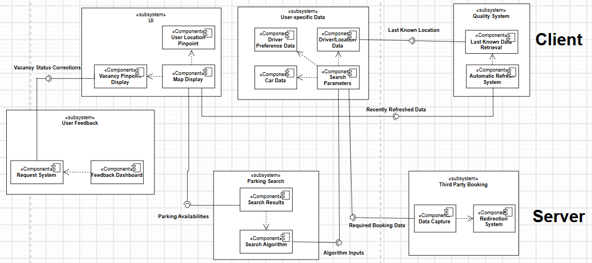
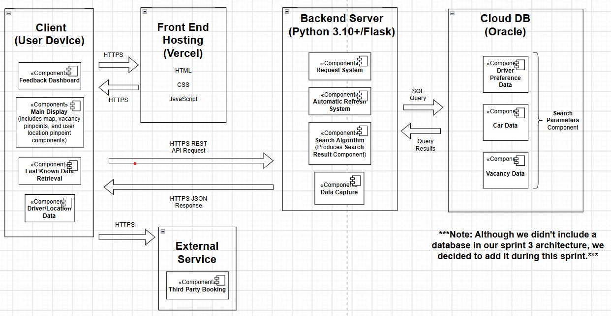

# Moth Incorporated — Oakland Parking App

Helps Pitt students, faculty, and visitors see where legal parking is available in Oakland before they arrive.

## Tech Stack

| Layer | Technology | Justification |
|---|---|---|
| Language | JavaScript (Node.js 20+) | One language across client and server, so every team member can read all code. |
| Frontend (planned) | React + Vite | Its state/timer hooks suit the Quality System's 5-minute auto-refresh (NFR1) and offline cache (NFR5). Not started. |
| Backend | Node.js + Express | The Parking Search subsystem is a single search algorithm (Sprint 3), so a lightweight server fits better than a heavy framework. |
| Database (planned) | SQLite | No server to install on 6 laptops. Not started; the skeleton uses hardcoded mock data because a real vacancy data source is a known risk (Sprint 2 retro). |

## Architecture




| Subsystem (Sprint 3) | Folder | Status |
|---|---|---|
| UI | `client/src/ui/` | Not started |
| User-Specific Data | `client/src/user-specific-data/` | Not started |
| Quality System | `client/src/quality-system/` | Not started |
| User Feedback | `client/src/user-feedback/`, `server/src/user-feedback/` | Not started |
| Parking Search | `server/src/parking-search/` | Search endpoint on mock data, radius check (C1) |
| Third Party Booking | `server/src/third-party-booking/` | Not started |

## How to Run

**Prerequisites:** Node.js 20 or newer (`node -v`), npm 10+, Git.

```bash
git clone https://github.com/siddh1709/oakland-parking-app.git
cd oakland-parking-app/server
cp .env.example .env        # Windows: copy .env.example .env
npm install
npm start
```

**Check that it works:**
1. `http://localhost:3001/health` returns `{"status":"ok"}`.
2. `http://localhost:3001/api/search?lat=40.4444&lng=-79.9533&radius=1` returns `count: 3`.
3. The same URL with `radius=6` returns an error (constraint C1).

## Status

**Works:** server starts, `/health`, search endpoint on mock data, radius validation (C1).

**Not yet:** client/UI, database, offline cache and auto-refresh, filters, favorites, feedback, third-party booking, real vacancy data source, legality check (C2).

## Team skeleton verification

| Member | OS | Result |
|---|---|---|
| Dev | | |
| Kyu | | |
| Nick | | |
| Nile | | |
| Rohan | | |
| Siddharth | | |
